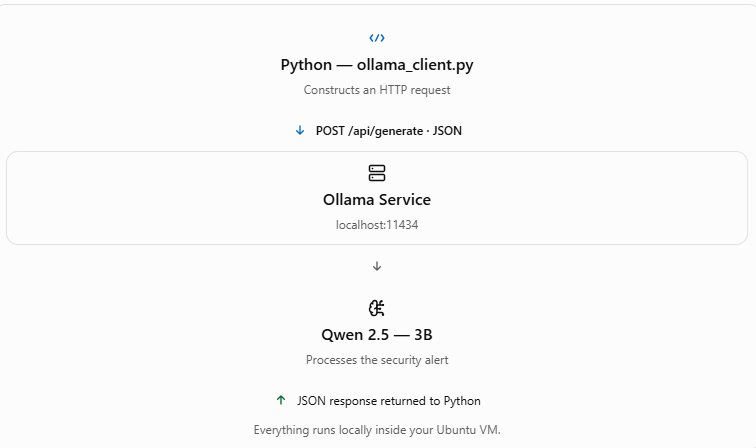
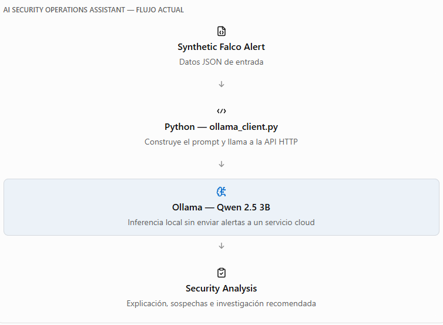
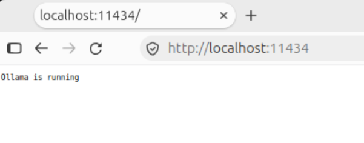

### Architecture Overview

This project implements a local AI-assisted security analysis workflow.

Synthetic security alerts are stored as JSON files and processed by a Python client (`src/ollama_client.py`).  
The client builds a constrained prompt and sends it to a locally hosted Ollama model through its HTTP API.  
The model generates a security-oriented analysis focused on:
- observed facts
- potential suspicion indicators
- recommended investigation steps

The laboratory is designed to support validation, evidence collection, and documentation through the `tests/`, `evidence/`, and `reports/` directories.

No alert data is sent to external cloud AI services; inference runs locally through Ollama.


## Architecture Diagram

The following diagram illustrates the architecture of the
AI Security Operations Assistant, including its components
and interactions.




```mermaid
flowchart TD
    U[Security Analyst cd ../ User]


## Current Processing Flow

This diagram shows how a synthetic security alert is processed
by the Python client and analyzed using the local Ollama LLM.



## Ollama Runtime Verification

The following screenshot provides evidence that the local
Ollama service is running and available for inference.



